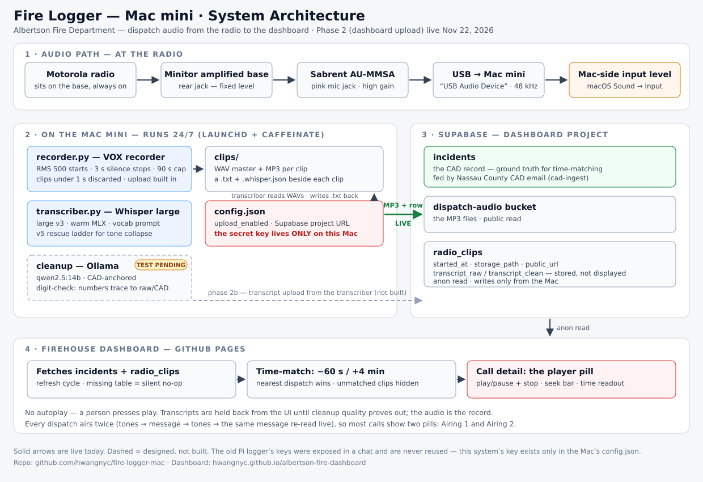

# Fire Logger — Mac mini

A voice-activated dispatch recorder for a volunteer fire department.
It listens to a Motorola radio sitting on a Minitor amplified base
through an $9 USB sound card. When a call comes in, it records. When
the audio stops for 3 seconds, it saves the clip — a WAV master plus
an MP3 copy — and goes back to listening.

It replaces a Raspberry Pi version that died, and keeps the original
script's exact recording settings (48 kHz mono, RMS threshold 500,
3-second silence stop, 90-second cap). Built for the Albertson Fire
Department; runs 24/7 on an M4 Mac mini.



## How it works

```
Radio → Minitor amplified base → 3.5 mm cable → Sabrent AU-MMSA (mic in)
      → USB → Mac mini → recorder.py (PyAudio VOX) → clips/ (WAV + MP3)
```

- **recorder.py** — the VOX recorder. Sound louder than `threshold`
  (RMS 500) starts a recording; 3 s of silence ends it; clips under
  1 s are discarded as squelch clicks; 90 s hard cap. With
  `mic_id: null` it auto-detects the USB input device.
- **launchd agent** (`com.henry.firelogger.plist`) — starts the
  recorder at login and restarts it if it ever crashes.
- **caffeinate** — the recorder runs under Apple's `caffeinate -i`,
  so the Mac never idle-sleeps while logging. The display can sleep.
- **firelogger.log** — live, unbuffered log of every trigger/save.
- **transcriber.py** — a second, independent agent (see
  "Transcription" below) that turns every clip into text with a
  locally hosted Whisper model. The recorder never waits on it.

## Hardware

| Piece | Notes |
|---|---|
| Motorola radio on a Minitor amplified base | The base's rear jack is **fixed-level** — the volume knobs drive the speakers, not the jack |
| Sabrent AU-MMSA USB sound card | Cable goes in the **pink/red mic jack** (high gain!). M4 mini has no USB-A, so use a USB-C adapter/hub |
| Mac mini (Apple Silicon) | Homebrew + ffmpeg + portaudio |

## Install

1. Put this folder in your **home folder** — *not* on the Desktop
   (see "Lessons" below), e.g. `~/fire-logger-mac`.
2. First run — installs dependencies (Homebrew Python venv, PyAudio)
   and starts the recorder in a Terminal window so you can watch it:
   ```
   bash START-FIRE-LOGGER.command
   ```
   Make the radio talk; a clip should land in `clips/`. Ctrl+C stops.
3. Make it permanent — installs the launchd agent:
   ```
   bash INSTALL-AUTOSTART.command
   ```
   Click **Allow** if macOS asks about microphone access.
4. To stop it for good: `bash STOP-FIRE-LOGGER.command`.

Config lives in `config.json` (created on first run;
`config.example.json` shows the defaults). **Never commit
`config.json`** — if you enable the dashboard upload, its key lives
there and nowhere else.

## Transcription (Whisper, fully local)

A separate launchd agent (`com.henry.firetranscriber`) runs
**transcriber.py**, which keeps the Whisper large model
(`whisper-large-v3-mlx`, via MLX on Apple Silicon) loaded in memory
and watches the clips folder. Each new clip gets a transcript beside
it — `<clip>.txt` plus a timed `<clip>.whisper.json` — and a line in
`transcriber.log`. Nothing leaves the Mac. It has its own Python
environment (`.venv-whisper`) and never touches the recorder: if
transcription breaks, recording doesn't notice.

Install (after the recorder works):
```
bash INSTALL-TRANSCRIBER.command
```
Stop it with `STOP-TRANSCRIBER.command`. Settings ride along in the
recorder's `config.json`: `whisper_model` (default `large`) and
`whisper_prompt` — a vocabulary hint with local names ("Firecom
dispatch for Albertson and Williston Park. Signal 9A. Signal 110."),
which measurably helps proper nouns.

Field lessons baked into v5, from the first real call (#499,
Nov 21, 2026 — a school auto alarm whose two airings were recorded
and transcribed hands-free):

- Whisper's decoder can **collapse on the opening alert tones** and
  return "!" for loud, clear audio. Every pass now runs with
  `condition_on_previous_text=False`, and an empty result on
  measurably loud audio triggers a rescue ladder: retry without the
  prompt, then retry in 10-second chunks. Verified live: the failed
  airing was recovered by the ladder (the no-prompt retry).
- Tone-trimming was tried and **rejected**: at 100 ms resolution,
  tones and speech interleave too closely to cut safely.
- Even rescued, radio transcripts are **drafts**. Fast, clipped
  dispatch speech garbles street names and invents filler. The
  planned next stage anchors cleanup to the CAD record (call type,
  address, cross streets from the dispatch email) with a hard rule:
  no number may appear in a cleaned transcript unless it traces to
  the raw transcript or the CAD record. The audio stays the record.

### Set the level on the Mac, not the radio

The base jack is fixed-level and the Sabrent's mic input is
high-gain, so recordings can clip even with every knob at minimum.
The knob that works is **System Settings → Sound → Input → the USB
device's input volume slider**. A healthy test transmission triggers
around Vol ≈ 2,000 in the log; constant triggers at Vol ≈ 20,000+
mean noise, not signal.

## Lessons learned (the hard way)

- **Seat the cable fully.** A half-seated plug fed the recorder pure
  static at full volume — it recorded back-to-back 90-second clips
  for 3 hours (~190 clips, 1.2 GB) before anyone noticed. Headphones
  at the base jack proved the source was fine in 30 seconds.
- **Don't run a background agent from the Desktop.** macOS
  privacy-protects the Desktop (and it may be iCloud-synced). The
  launchd job died instantly with exit code 78 (EX_CONFIG) and wrote
  nothing to its log. Moving the folder to the home folder fixed it.
- **Terminal output through `tee` is block-buffered** — the recorder
  looked dead while it was actually recording. The clips folder's
  contents (and `python -u`) tell the truth.

## Phase 2 — dashboard click-to-listen (prepared, not live)

The end goal: when a call appears on the firehouse dashboard screen,
a ▶ button plays the dispatch audio. The recorder already knows how
to upload (`upload_enabled` + a key in `config.json`, on the Mac
only). The dashboard side — a Supabase storage bucket + `radio_clips`
table, and a small dashboard patch that time-matches clips to calls
(clip start within −60 s/+4 min of dispatch time) — is in
[`dashboard/`](dashboard/). It has **not** been applied to the live
dashboard.

## Files

- `recorder.py` — the recorder (VOX, saving, optional upload)
- `run-logger.sh` — launchd entry point (caffeinate wrapper)
- `START-FIRE-LOGGER.command` — first-run setup + manual start
- `INSTALL-AUTOSTART.command` / `STOP-FIRE-LOGGER.command`
- `com.henry.firelogger.plist` — launchd template (`__FIRELOGGER_DIR__`
  is filled in by the installer)
- `transcriber.py` — the warm Whisper transcription daemon (v5)
- `run-transcriber.sh` — its launchd entry point
- `INSTALL-TRANSCRIBER.command` / `STOP-TRANSCRIBER.command`
- `com.henry.firetranscriber.plist` — its launchd template
- `dashboard/` — phase-2 SQL + patch plan
